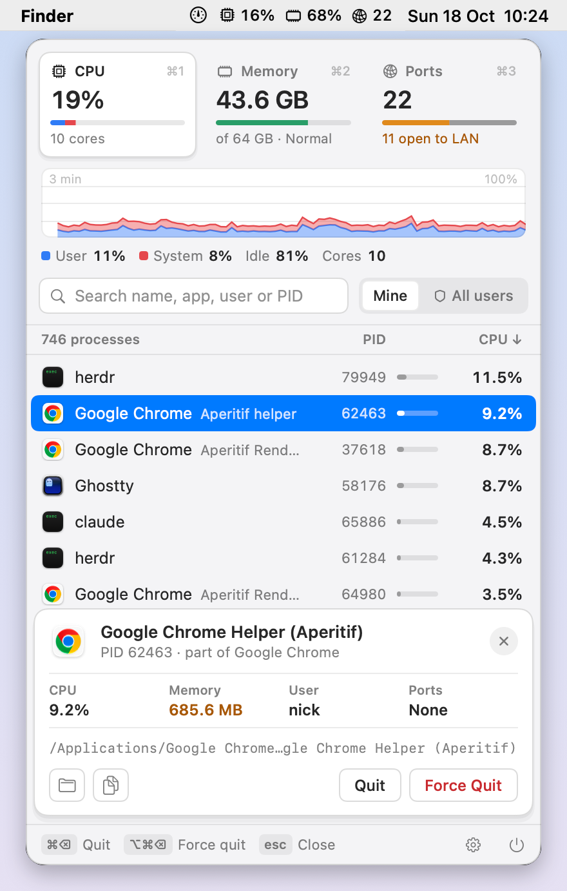

# Dobby

Dobby is a free macOS menu bar process monitor — a lighter, clearer take on Activity Monitor.

## Demo



## Features

- **Vitals tiles.** CPU, Memory and Ports sit side by side at the top with their totals, a meter and a one-line summary. Click a tile or press `⌘1` / `⌘2` / `⌘3` to switch views. CPU and Memory show iStat Menus–style history graphs (CPU split into user/system, memory colored by pressure) with a legend; Ports shows filters instead.
- **Readable, stable lists.** CPU and memory lists sort by usage, highest first. Helpers are listed under their app with their role ("Google Chrome · Renderer helper"). Rows stop reordering while the pointer is over the list (the header shows **Paused**), so you never click the wrong process.
- **Port exposure at a glance.** The Ports view lists listening TCP and bound UDP ports by port number and filters them by reach: **All**, **LAN** (reachable from the network, in orange) or **Local** (this Mac only).
- **Details card.** Selecting a row docks a card under the list: CPU, memory, owner, ports held (or, for a port, its reach, address and the other ports the same process holds), the executable path, and buttons to show it in Finder, copy the PID or port, or open a TCP port in the browser.
- **Quit or force quit.** Hover a row and click the **×** that replaces its icon, or select it and choose **Quit** — apps get a normal Quit, other processes get SIGTERM — or **Force Quit** — SIGKILL; the button turns into **Confirm Force Quit** and explains the consequence, so press it twice. Closing a port means ending the process that holds it. Protected processes show a lock instead.
- **Keyboard first.** Type to search, `↑` / `↓` to select, `⌘⌫` to quit, `⌥⌘⌫` to force quit, `⌘1` / `⌘2` / `⌘3` to switch views, `⌘,` for settings, `Esc` to back out one step (settings, selection, search, then the panel), `⌘Q` to quit Dobby. The footer shows the shortcuts that apply right now, and the result of the last action.
- **Light on resources.** Processes are sampled only while the panel is open (and not while the settings view is showing). A process's path and name are read once and cached until it exits or execs, so a sample of ~700 processes takes about 2 ms. System totals for the graphs are sampled in the background with two cheap host calls.
- **Settings** (gear icon in the footer, or `⌘,`):
  - **Appearance**: System, Light or Dark, remembered across launches.
  - **Show stats next to the icon**: adds an iStat Menus–style readout next to the menu bar icon — CPU %, memory used % and the number of open ports, each as an icon plus a number, with a live preview. Choose which **items** to show. Hover the readout for the full values. Memory turns orange when memory pressure is high. While the ports item is shown, Dobby also counts ports in the background (a few milliseconds per refresh).
  - **Flag new LAN ports**: turns the ports count orange when a process starts listening on the network, until you open the Ports view; the tooltip names the process and port.
  - **Launch at login**: starts Dobby automatically when you log in. macOS may ask you to allow it under *System Settings › General › Login Items*; Dobby opens that page for you, and **Open Login Items…** gets you back there. You can also turn it off there.
  - **Refresh every** 1, 2 or 5 seconds.
- **All users**: next to the search field, **Mine** / **All users** chooses whose processes and ports are listed. See below.

### All users

Choosing **All users** first explains what happens; **Continue…** asks for an administrator password, then starts `DobbyHelper` as root. The list header shows **Admin helper on** while it runs. The helper:

- only reads process and port data and relays SIGTERM / SIGKILL;
- accepts requests only from the Dobby process that launched it;
- exits when Dobby quits or you switch back to **Mine**, so nothing stays installed.

`launchd`, `kernel_task`, `WindowServer` and `loginwindow` can never be ended from Dobby.

## Requirements

- macOS 14 or later
- Swift 6 (the Command Line Tools are enough; Xcode is not required)

## Build and run

```sh
./scripts/test.sh        # unit tests plus live process, socket and helper tests
./scripts/build-app.sh   # builds build/Dobby.app (ad-hoc signed)
open build/Dobby.app
```

The app icon is drawn in code: edit `scripts/make-icon.swift`, then run `swift scripts/make-icon.swift` to regenerate `Resources/AppIcon.icns`.

`scripts/test.sh` works around a Command Line Tools bug where SwiftPM sometimes fails to find the swift-testing macro plugin.

Launch at login and All users need the bundled app: run Dobby from `build/Dobby.app` (ideally moved to `/Applications`), not via `swift run`.

## Snapshots

To render the panel to a PNG without opening it:

```sh
DOBBY_SNAPSHOT=out.png .build/debug/Dobby
```

Optional variables:

| Variable | Values |
| --- | --- |
| `DOBBY_SNAPSHOT_TAB` | `memory`, `ports`, `all-users` (the All users explanation), `settings`, `menubar` (the menu bar readout), `menubar-alert` (the readout with high memory pressure and a new LAN port); default: CPU |
| `DOBBY_SNAPSHOT_THEME` | `system`, `light`, `dark` |
| `DOBBY_SNAPSHOT_SELECT` | row index to select |
| `DOBBY_SNAPSHOT_WAIT` | seconds to wait before capturing (default `2.6`) |

## License

MIT — see [LICENSE](LICENSE).
