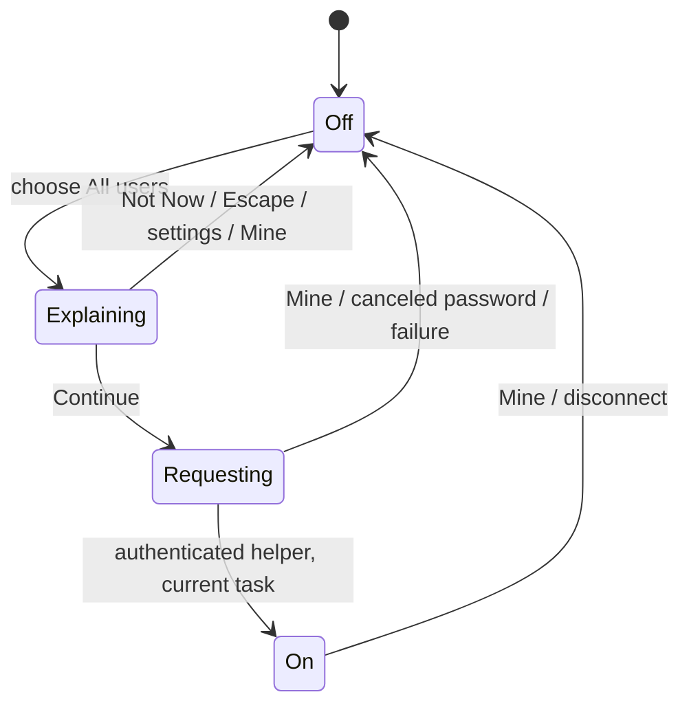
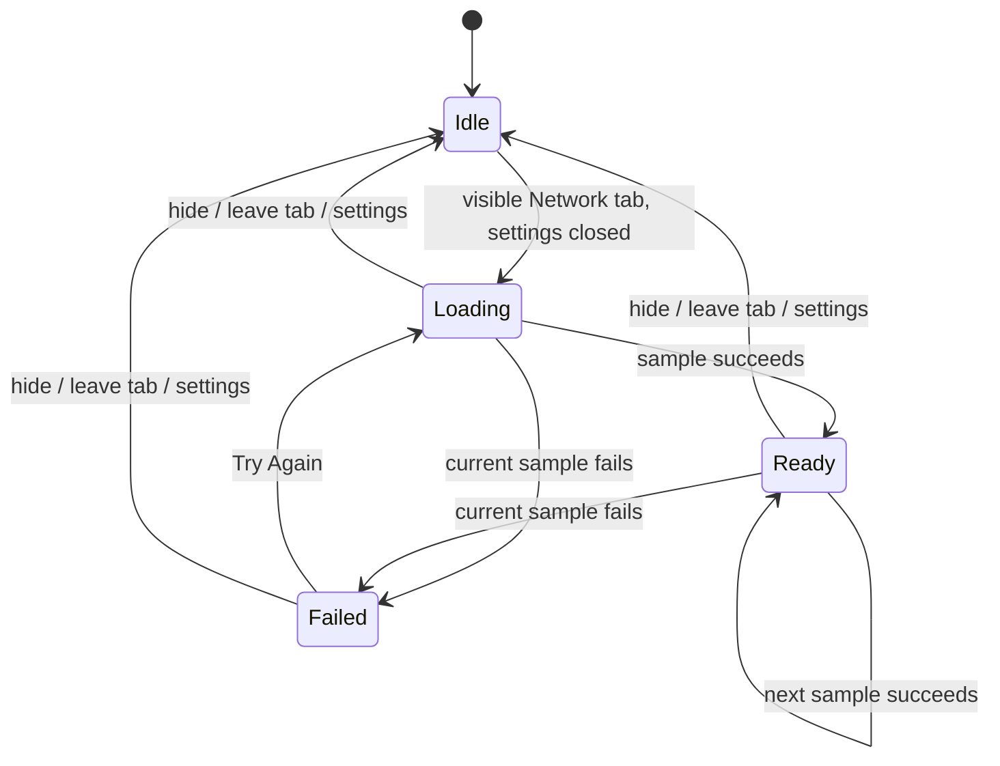

# Dobby state machines

Dobby has 27 stateful flows across the panel, samplers, helper and development renderer. Several were already explicit enums; others live in task handles, optional baselines, cached values or combinations of view properties. This inventory covers `Sources/Dobby`, `Sources/DobbyCore` and `Sources/DobbyHelper`.

## Decision

Keep each flow with its existing owner. Use explicit enums for mutually exclusive asynchronous states, and derive eligibility for work from the panel's independent visibility, screen and tab choices. A single application-wide state machine would couple unrelated settings and create unnecessary combinations.

`ProcessMonitor.SystemAccess` now owns `off → explaining → requesting → on`. `ProcessMonitor.NetworkState` owns `idle → loading → ready / failed`. The explanation, spinner, retry button and settings status derive from those states. `shouldSampleProcesses` is the shared rule for process work: the panel is visible and settings are closed. Background system totals and optional port counts keep their separate lifecycles.

Only a current task may publish its completion or error. Switching to Mine cancels the startup task; a late helper is closed. Stopping or replacing network sampling cancels its task; even a non-cancellation error from that old task cannot overwrite the current session. Starting administrator access changes state synchronously, before scheduling its task, so repeated Continue actions cannot start multiple prompts.

This improves UX through predictable cancellation and recovery, DX through explicit ownership and focused tests, and agent experience through awaitable operations and this searchable map. No new dependency or state-machine framework is required.

## Inventory

Paths below are relative to the repository root. Related views project the state owned by their model; they do not own competing copies.

| # | Flow and owner | States and transitions | Invariant / verification |
| --- | --- | --- | --- |
| 1 | Panel presentation — `Sources/Dobby/StatusPanel.swift`, `StatusPanelController` | Hidden → show under menu item → key/open → outside click, key loss or Escape → hidden. A 250 ms dismissal interval prevents the same click reopening it. | One outside-click monitor while open; hide removes it. Frame calculation has `PanelPlacementTests`; click delivery remains a native integration check. |
| 2 | Window visibility observation — `Sources/Dobby/Components.swift`, `WindowVisibilityReader` | Detached/closed → hidden; attached visible window → visible; occluded → hidden; notifications report changes. | Deduplicates notifications. Visibility drives sampling because the hosting view survives panel dismissal. |
| 3 | Screen and metric navigation — `Sources/Dobby/ProcessMonitor.swift`, `isShowingSettings`, `tab` | CPU / memory / ports / network; settings temporarily replaces the main screen. | A tab change clears selection/hover and rebuilds ranking. Settings cancels network sampling, disarms force quit and dismisses an explanation. Returning catches up immediately when visible. |
| 4 | Search and port reach — `Sources/Dobby/ProcessMonitor.swift`, `query`, `portReach` | Empty / nonempty query; all / network / local port reach. | Search rebuilds both projections; counts describe search matches before reach filtering. Invisible selections are cleared. `PortTests`, `PanelLogicTests`, `UsageLogicTests`. |
| 5 | Hover and frozen order — `Sources/Dobby/ProcessMonitor.swift`, `isPointerInList`, `hoveredRowID`; `Sources/DobbyCore/ProcessRanking.swift` | Pointer outside → normal ranking; inside → preserve surviving process positions, append newcomers; leaving → rerank. | Values keep updating. Hover leave clears only the same row. Process order has core coverage; port rows keep their existing port-based sort. |
| 6 | Selection and inspector — `Sources/Dobby/ProcessMonitor.swift`, `selection`, `portSelection`, `selectedTarget` | None ↔ process identity (PID + kernel start token) or port binding; arrow navigation clamps at list ends; disappearance clears selection. | The active tab determines the action target. Changing selection disarms force quit. `ContentView` and `Inspector` project this state. A recycled PID clears the selection; its replacement has a different row identity. |
| 7 | Escape/back navigation — `Sources/Dobby/ProcessMonitor.swift`, `cancel`, `canCancel` | Undo settings → explanation → force-quit confirmation → selection → search; otherwise the panel handles Escape. | One step per press. Confirmation cancellation preserves selection. `ProcessMonitorTests.escapeDisarmsForceQuitBeforeClearingSelection`. |
| 8 | Force-quit confirmation — `Sources/Dobby/ProcessMonitor.swift`, `confirmingForceQuit`, `forceQuitTask` | Disarmed → armed for process identity → second activation executes; 3 seconds, selection change, settings or panel dismissal disarms. | A canceled old timer cannot disarm a newer confirmation. App-model regressions cover timer replacement, dismissal and Escape. The existing context-menu direct action is described below. |
| 9 | Termination dispatch — `Sources/Dobby/ProcessMonitor.swift`, `perform`; `Sources/DobbyCore/ProcessTerminator.swift` | Reject protected target; graceful app quit or SIGTERM; confirmed/direct force action sends SIGKILL; report success or typed error; delayed refresh. | Signal delivery is not proof of process exit. Native and helper signals validate identity and use an audit token. Refresh runs only when process sampling is eligible. `LiveProcessTests` exercises expendable child processes and error mapping. |
| 10 | Action notices — `Sources/Dobby/ProcessMonitor.swift`, `Notice`, `show` | None → latest success/error → expire after 4 seconds; a new notice replaces the old one. | UUID equality prevents an old expiry from clearing a newer notice. Footer and settings show the same notice. |
| 11 | Administrator session — `Sources/Dobby/ProcessMonitor.swift`, `SystemAccess` | Off → explaining → requesting → on; explanation dismissal, password cancellation or failure → off; Mine cancels pending startup or closes the helper; disconnection falls back to own processes. | One authorized startup at a time; canceled results/errors cannot reactivate or overwrite another request. Injected helper acquisition tests cover cancellation, duplicate Continue, late completion and start/stop. |
| 12 | Panel process-sampling loop — `Sources/Dobby/ProcessMonitor.swift`, `refreshTask`, `start`, `stop` | Stopped → fresh baseline → 400 ms warmup → publish at chosen interval; settings suspends samples; hidden cancels the loop and resets elapsed time. | No process sample on a canceled initial task, behind settings, or from a delayed action while ineligible. `ProcessMonitorTests.settingsDoNotStartProcessSampling`. |
| 13 | Whole-system sampling and histories — `Sources/Dobby/ProcessMonitor.swift`, `sampleSystem`; `Sources/DobbyCore/SystemStats.swift`, `RingHistory` | CPU/network baseline → successive deltas; memory snapshots append immediately; history fills to 90 then drops oldest. Hidden panels retain history without view updates. | System totals continue independently of the expensive process loop. The system task does not hold the monitor across sleep. Counter math, memory and history rollover have core tests. |
| 14 | Process identity cache — `Sources/DobbyCore/ProcessSampler.swift`, `identities` | Missing/incomplete identity → lookup; matching start time, command and UID → reuse; changed identity → reread; excessive stale entries → prune. | Incomplete reads are retried. `LiveProcessTests` covers reads and shell-to-sleep exec. The start token reaches snapshots, rows and action targets. |
| 15 | Per-process CPU baseline — `Sources/DobbyCore/UsageCalculator.swift`; `ProcessMonitor.lastSnapshots`, `lastSampleTime` | No baseline, zero elapsed, name change or decreased counter → zero; otherwise derive CPU from counter delta / elapsed time. | Nonnegative usage; first sample after hiding starts a new time baseline. `UsageLogicTests`. Same-name PID reuse starts a new CPU baseline. |
| 16 | Network interface baselines — `Sources/DobbyCore/NetworkStats.swift`; `ProcessMonitor.lastInterfaces` | First observation → baseline; matching interface → delta; new or removed interface → no old-interval contribution; reset counter → zero. | Physical/PPP interfaces avoid double-counting virtual tunnels. Failed interface reads clear the baseline. `NetworkTests` covers reset and interface churn. |
| 17 | Process network session — `Sources/Dobby/ProcessMonitor.swift`, `networkState`, `networkTask` | Idle → loading → ready on samples; current error → failed; retry → loading; hiding, leaving Network or entering settings → idle. | A current task owns state and rates; published rates must match the captured process identity. App tests cover readiness, failure/retry, stale errors and late successes after cancellation. |
| 18 | nettop subprocess and output parser — `Sources/DobbyCore/NetworkStats.swift`, `NetworkProcessSampler` | Start child → drain output/wait → check cancellation and exit status → parse exactly two snapshots → rates; cancellation terminates child. | Malformed rows/header counts throw. New PIDs get zero initial traffic. `NetworkTests` covers parser errors, live sampling and cancellation. |
| 19 | Socket discovery and exposure — `Sources/DobbyCore/Ports.swift`, `PortScanner`, `PortBinding.exposure` | TCP LISTEN or bound unconnected UDP → service entry; merge by PID/protocol/port → loopback / all interfaces / specific address. | Local means IPv4 127/8, IPv6 loopback and mapped IPv4 loopback. Mixed LAN/local bindings stay LAN. `PortTests` covers real socket lifecycles, classification, aliases and alert consequences. |
| 20 | New LAN-port watch — `Sources/DobbyCore/Ports.swift`, `NewNetworkPorts`; `ProcessMonitor.flagsNewNetworkPorts` | No baseline → silent first scan → newly reachable keys become unseen → acknowledgment clears; closed ports disappear; toggling the feature resets the watch. | Keys use protocol/port, intentionally ignoring PID. Looking at Ports acknowledges alerts. `PanelLogicTests`; loopback-alias regression in `PortTests`. |
| 21 | Helper client connection — `Sources/DobbyCore/Helper.swift`, `HelperClient` | Create private listener → await connection → verify root UID → install channel/remove listener → close; timeout/rejected peer throws. | The private directory and socket are cleaned up. Helper exits on connection close. `HelperTests` covers peer verification, timeout and binary lifetime. |
| 22 | Helper framing, server and CLI — `Sources/DobbyCore/Helper.swift`, `LineChannel`, `HelperServer`; `Sources/DobbyHelper/main.swift` | Partial writes/reads advance until newline; decode request → snapshot/signal/error reply; disconnect exits. CLI requires a valid start token and verifies the launching client identity. | Requests use a serial RPC queue with a total deadline; only identity-bound TERM/KILL are relayed; reserved/helper PIDs are rejected. `HelperTests` covers round trips and authentication. Transport fault coverage is in `HelperIOTests`. |
| 23 | Menu-bar readout and alerts — `Sources/Dobby/StatusPanel.swift`, `observeMenuBarStats`, `Shown`; `Sources/Dobby/MenuBarReadout.swift`; `Sources/DobbyCore/MenuBarStats.swift` | Disabled/no selected items → icon; enabled → selected stats; unavailable → dash; sampled values → readout; pressure/unseen ports → colored alert. | Observation re-registers after change; equivalent presentation avoids image replacement. Background port counts also refresh while settings suspends the process loop. Store/formatting/alert tests live in `MenuBarStatsTests` and `PanelLogicTests`. |
| 24 | Preferences persistence — `Sources/Dobby/PreferencesSettings.swift`; `Sources/DobbyCore/Preferences.swift` | Absent/invalid → defaults; startup → cached typed values; UI edit → write through. Interval is 1, 2 or 5 seconds; menu items are a set. | Empty items mean icon only; LAN alerts require the ports readout. `PreferencesStoreTests` covers defaults, persistence and invalid intervals. External writes need relaunch. |
| 25 | Appearance — `Sources/Dobby/ThemeSettings.swift`; `Sources/DobbyCore/Theme.swift` | System / light / dark; load persisted choice → apply to NSApp; user changes apply/persist; snapshots disable persistence. | System means no forced NSApp appearance. `ThemeTests`; light/dark snapshot review. |
| 26 | Launch at login — `Sources/Dobby/LaunchAtLoginSettings.swift`; `Sources/DobbyCore/LaunchAtLogin.swift` | Off → register → on or needs approval; on/pending → unregister → off; errors reread service state; panel visibility refreshes external changes. | macOS owns truth; pending approval opens Login Items. `LaunchAtLoginTests` uses a fake service and covers idempotence and errors. Real approval needs native manual verification. |
| 27 | Development snapshot lifecycle — `Sources/Dobby/SnapshotRenderer.swift`, `runIfRequested` | No request → normal app; configured request → choose state/theme → sample/wait → optionally select → render PNG → exit; menu-bar modes render separately. | Uses normal monitor transitions, including the administrator explanation. Light/dark captures cover the main panel modes, selected process/port/network inspectors and the menu-bar readout. Rendering does not invoke administrator authorization or persist theme changes. |

Stateless projections such as display labels, unit formatting, panel geometry and filters do not add independently owned state. Memory pressure categories are current samples; their history and alert transitions belong to the system sampler and readout above.

## Transition diagrams

Mine cancels Dobby's request and discards its eventual result. macOS owns the password dialog; task cancellation does not forcibly dismiss that dialog. A helper that connects after cancellation is closed instead of being adopted.

Canceled sessions have no authority to update the diagram, including when cancellation surfaces as an ordinary error.

## Process identity and helper I/O guarantees

`ProcessIdentity` pairs the PID with `ri_proc_start_abstime`, the kernel's process start token. Snapshots preserve it through usage calculations, SwiftUI row IDs, frozen ranking, selection, force-quit confirmation, network attribution and port action targets. A port without an identified owner can be inspected, but its termination controls are unavailable.

`ProcessTerminator` revalidates the expected identity and current critical-process name before invoking any quit/signal callback. A normal app Quit obtains an `NSRunningApplication` object first, revalidates identity, then calls that same object, which represents a specific application instance. Raw signals acquire a task audit token, recheck the start identity, and use `proc_signal_with_audittoken`; the kernel binds delivery to the process generation. The helper receives the expected identity and repeats these checks. Its launch contract also requires the app PID and start token, verifies both against the socket peer, and rechecks that launching instance before serving each request. No production fallback calls `kill(pid)`.

The atomic signal API is present in Apple's macOS 15 source and absent from macOS 14. Dobby resolves it dynamically, so both binaries can retain a macOS 14 deployment target without a hard dependency on the newer symbol. When absent, monitoring and normal app Quit remain available; raw SIGTERM/SIGKILL returns `ENOTSUP`, Force Quit controls are disabled, and the user sees the capability requirement. Administrator access cannot enable an OS capability that is missing.

Helper RPCs run on a serial dispatch queue. One absolute monotonic deadline starts before queue submission and covers queue residence, all writes, all reads and response validation. Default budget: three seconds. Nonblocking sockets plus readiness polling bound a silent peer, trickled input and a peer that does not read. Every I/O, decoding or response-type failure closes the session, so a late reply cannot become a later request's result.

`close()` shuts down active sockets without waiting for the RPC queue. Active operations retain their channel until they finish, preventing descriptor reuse while I/O is still accessing it. Accept/close races cannot install a connection after closure. App snapshot consumers also verify cancellation, sampling generation, helper object identity and current visibility before publishing data or handling failure.

A lost signal reply does not prove whether the signal was delivered. Dobby reports the lost connection and asks the user to check the list; it does not automatically resend a termination request. Retrying against a recycled PID still fails identity validation.

Relevant checks: same-name CPU reuse, frozen-order reuse, process and port selection/confirmation resets, direct and helper stale-target refusal, launching-client start-token rejection, required CLI identity validation, current critical-executable refusal, a real helper feeding the visible panel, missing-symbol refusal, silent/trickling/non-reading peers, shared/queued deadlines, malformed and unexpected replies, late replies, EOF, main-actor responsiveness, and close/accept races.

Platform references: Apple's [macOS 14 process implementation](https://github.com/apple-oss-distributions/xnu/blob/xnu-10002.1.13/bsd/kern/proc_info.c), [macOS 15 process implementation](https://github.com/apple-oss-distributions/xnu/blob/xnu-11215.1.10/bsd/kern/proc_info.c), and the SDK's `libproc.h`, `mach/task_info.h` and `NSRunningApplication.h`.

## Verification

Run `./scripts/test.sh` for both targets. The original baseline was 87 core tests. The current suite contains 15 app-model tests and 108 core tests, including parameterized address and malformed-reply cases.

The app tests exercise the real `ProcessMonitor`. System boundaries can be injected: process/socket sampling, helper acquisition and process-network sampling. Continuations hold those boundaries until the test delivers a result; returned task handles let tests await completion without polling or administrator privileges. The confirmation-timer regression deliberately crosses the real three-second timer window.

The network stale-error, settings-sampling and force-confirmation regressions were observed failing before their fixes. Loopback-address tests also failed before the exposure fix. A same-name recycled-PID fixture reproduced 400% inherited CPU before the identity fix and 0% afterward. The original helper client accepted three invalid/wrong-response sequences followed by buffered valid replies; those regressions now pass. `./scripts/build-app.sh` verifies the release build and produces the ad-hoc signed `build/Dobby.app`.

Snapshot checks cover CPU, ports, network loading, All users explanation and settings in light/dark appearance. They verify layout and rendering, not password approval or actual launch-at-login registration. Current-host tests cover missing atomic-signal capability by injecting an unavailable native entry point; actual macOS 14 execution remains unverified. Live core tests use temporary child processes, sockets and an unprivileged helper fixture.

## Remaining limitations and deliberate behavior

These findings are separate from the corrected regressions. They are not claims that each failure has occurred on this Mac.

- **Executable metadata:** an exec with an unchanged short command can retain a cached executable path. Signal-time checks reread the current identity and critical process name; cached display metadata does not authorize an action.
- **Unavailable versus empty data:** process/socket scan failures can look like missing or empty results; a later recovery may reflag an existing port. Memory-pressure read failure currently maps to normal. These boundaries need explicit unavailable results before the UI can represent them accurately.
- **Port-alert identity and scope:** a restarted server on an already-known protocol/port is intentionally silent. Changing Mine/All users changes the observed population without resetting the alert baseline, so newly visible pre-existing ports can appear new.
- **External settings:** cached preferences/theme/readout settings do not reload external defaults writes until relaunch. Login-item state refreshes on panel visibility or setter failure; an approval change while the panel stays open may remain stale.
- **Destructive context menu:** the existing row context menu sends its explicit Force Quit action directly (`confirmed: true`). Inspector buttons and keyboard shortcuts use the timed confirmation. This change preserves that existing distinction.
- **Child lifetime and history timing:** nettop cancellation sends TERM without an escalation deadline. History points have no timestamps; the displayed span uses the current interval, so changing intervals temporarily makes it approximate.

Administrator password approval and actual login-item registration were not exercised. They change system-level state and need a bundled-app manual check. The app build and injected session tests do not establish those OS interactions.
